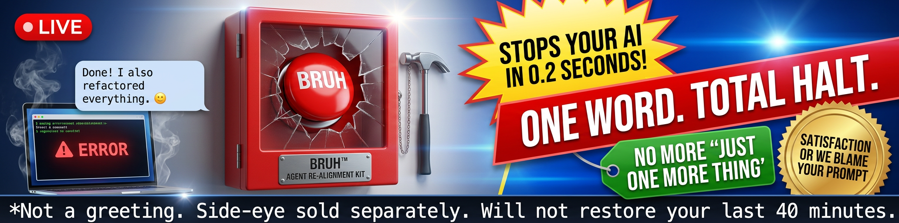
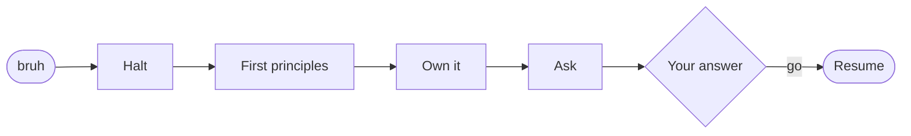

One word that tells your agent it just went off the rails. `/bruh` makes Claude stop, own it, and ask what you actually wanted before it touches anything else.

## What it does

- **Halts** all changes on the spot. No "just finishing this one thing."
- **Resets** to the real goal, in your words instead of its reframing
- **Owns it.** No paragraphs of justification.
- **Asks** a real question you can answer, then waits for your go



## Install

```bash
mkdir -p ~/.claude/skills/bruh
cp SKILL.md ~/.claude/skills/bruh/SKILL.md
```

Start a new Claude Code session to pick it up.

## Usage

Type `bruh` (or `bruh?`, `bruh.`, `/bruh`) the moment the agent goes sideways.

Not to be confused with **/bully**: bully means *right work, wrong pace*. bruh means *wrong work*. If both apply, it's bruh.

## Requirements

- [Claude Code](https://claude.ai/code) with skills enabled

## License

[MIT](LICENSE)

---

Built by **Jerry Reinitz** · [github.com/JR91387](https://github.com/JR91387) · [jerryreinitz.com](https://jerryreinitz.com)<br>
Midwest AI and software engineer who builds for people, not for checkboxes.
